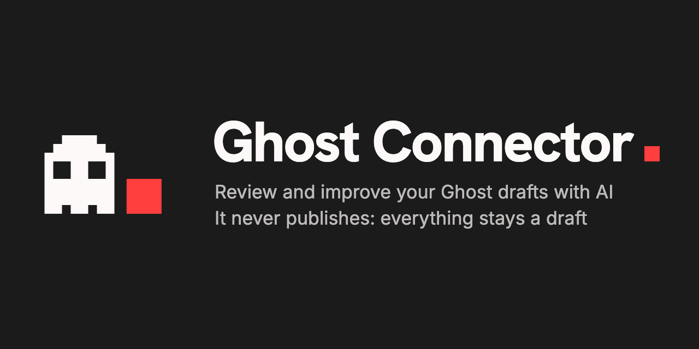

<p align="center"></p>

<p align="center">
  <strong>AI subagents that finish, optimize and illustrate your <a href="https://ghost.org">Ghost</a> drafts — and hand them back for you to review.</strong>
</p>

<p align="center">
  <a href="LICENSE"></a>
  
  
  
</p>

> [!IMPORTANT]
> **It never publishes.** Everything stays at `status: draft` — there isn't even an option to publish. Publishing is always your call, in Ghost.

## 📚 Contents

- [✨ Features](#-features)
- [📋 Requirements](#-requirements)
- [🚀 Quick start](#-quick-start)
- [🖥️ The web panel](#️-the-web-panel)
- [👥 Users and teams](#-users-and-teams)
- [⌨️ The CLI](#️-the-cli)
- [💾 Export, import and backups](#-export-import-and-backups)
- [🐳 Docker and servers](#-docker-and-servers)
- [🖼️ Images and attribution](#️-images-and-attribution)
- [🗂️ Where things live](#️-where-things-live)
- [🌍 Translations](#-translations)
- [🔒 Security](#-security)
- [🛠️ Development](#️-development)

## ✨ Features

- ✍️ **Writes and improves drafts** — completes an outline or polishes a full post, in the draft's own language, following your instructions. You watch the text being written live.
- 🔎 **SEO built in** — meta title and description, slug, excerpt, tags, social cards, a quality score and a Google/share preview. **Fix with AI** rewrites only what the checklist flags.
- 🖼️ **Featured images** — candidates from Unsplash, Pixabay, Pexels, Openverse and Wikimedia Commons, with proper attribution in the caption.
- ✅ **Block-by-block review** — accept or reject each change; what you reject turns into suggestions for the prompt.
- 💡 **Ideas from your search data** — Google Search Console and Bing Webmaster Tools show what you almost rank for, plus AI topic ideas from your posts.
- 🤖 **Multi-model** — DeepSeek (`deepseek-flash`) by default, Claude (Anthropic) or any OpenAI-compatible API (OpenAI, OpenRouter, Groq, Ollama…), with a different model per agent if you like, and a daily spending cap.
- 👥 **Made for teams** — users with roles, 2FA, invites, assignments, notes, presence and an activity log.
- ↩️ **Safe by design** — conflict checks before writing, Ghost keeps a revision, and the last apply can be undone.

There are two ways to use it on top of the same core (what one does, the other sees): a **[web panel](#️-the-web-panel)** and a **[CLI](#️-the-cli)** for scripts, cron or large batches.

## 📋 Requirements

| | |
|---|---|
| 🟢 **Node.js 24+** | Or just [Docker](#-docker-and-servers). |
| 👻 **Ghost Admin API Key** | Ghost Admin → *Settings → Integrations → Add custom integration*. The Content API Key won't do: it can't write. |
| 🤖 **An AI provider key** | [DeepSeek](https://platform.deepseek.com) (default), [Anthropic](https://console.anthropic.com) or any OpenAI-compatible one. For models other than `deepseek-flash`, set their price in `AI_PRICES` to see costs. |
| 🖼️ **Image keys** *(optional)* | [Unsplash](https://unsplash.com/developers), [Pixabay](https://pixabay.com/api/docs/), [Pexels](https://www.pexels.com/api/). Without them, [Openverse](https://openverse.org) and Wikimedia Commons are used (no key). |
| 📈 **Search data** *(optional)* | A read-only Google Search Console service account and/or a Bing Webmaster Tools API key, for *Ideas* and *Results*. |

## 🚀 Quick start

```bash
git clone <repo> ghost-connector && cd ghost-connector
npm install
npm run dev -- setup    # wizard: Ghost, AI, images, what your blog is about
npm run dev -- serve    # opens the panel in your browser
```

`setup` asks for what it needs, hides keys as you type, **tests each connection** and saves the configuration with `0600` permissions. Run it again any time (Enter keeps each value), or copy `.env.example` to `.env` and fill it in by hand — every variable is commented.

> [!TIP]
> **Start carefully:** limit drafts to a test tag (*Settings → which drafts to process*, or `DRAFT_FILTER`), plan and apply a single post, check it in Ghost, and only then widen the filter and raise `MAX_POSTS_PER_RUN`.

## 🖥️ The web panel

The first time, the panel asks you to create the first user — the **owner** — and then offers two-step verification (TOTP plus recovery codes): optional, but highly recommended. From then on you log in at `http://127.0.0.1:4300`; locally, `serve` opens the browser already logged in with a one-time link (`--no-open` to skip it).

**The usual flow:**

1. 📝 **Drafts** — your drafts, with whatever needs review at the top. `⌘K` searches everything; `j`/`k` and `Enter` move around; `?` lists all shortcuts.
2. 🧠 **Plan** — the writer completes (*draft* mode) or improves (*improve* mode) the post, optionally with your instructions; SEO and the image are planned at the same time, and it may link 1–3 related posts from your blog.
3. ✅ **Review changes** — block by block, accept or reject each one.
4. 🖼️ **Image** — pick from your sources' candidates (or none), edit alt text and caption. It's only uploaded to Ghost when you apply.
5. ✏️ **Edit** — touch up the text by hand, with a live preview and the quality checklist.
6. 🚀 **Apply to Ghost** — checks first (conflicts, `[[PENDING]]` markers, suspicious length changes); the post stays a draft and Ghost keeps a revision.
7. 🕘 **History** — every apply attempt, and **Restore the previous version** while nobody has touched the post since.

**Also in the panel:**

| | |
|---|---|
| 📊 **Results** | Clicks, impressions, CTR and position of published posts (Search Console and/or Bing), last 28 days vs the 28 before, with a weekly trend marking when the panel changed each post. Read-only, refreshed by hand, exportable as CSV. |
| 💡 **Ideas** | Searches where you show up on page two with real impressions; first-page results with unusually few clicks, where the AI proposes three titles/meta descriptions to apply (and restore); and AI topic ideas. Each opens *New post* already filled in; dismissed or used ideas don't come back. |
| 🌙 **Nightly plan** | With `AUTO_PLAN_TIME`, once a day it plans drafts that were never planned (at most `AUTO_PLAN_MAX`, 3 by default). It only plans: applying is up to you. |
| ⚙️ **Jobs** | Background work (plan, apply, sync) with live progress and logs. If the process dies mid-batch, finished work is kept. |
| 🔧 **Settings** | Every option with *Test connection*, which drafts to process, image source order, language, prompt editor (revert to factory any time), usage and cost per day and per agent, an optional daily cap (`AI_DAILY_BUDGET_USD`) and one per user (`AI_USER_DAILY_BUDGET_USD`), and, for the owner, costs per user: spend and tokens by user, agent and model, and the most expensive posts. Keys are never shown, only replaced. |

## 👥 Users and teams

Each person has their own username, password and 2FA. New users join through **single-use invite links** (valid 7 days) created in *Settings → Users*, which can also send a link to set a new password, remove 2FA or delete a user.

Each user can also have **default Ghost authors** (one or more, from your Ghost staff): posts they create from the panel are credited to them instead of the site owner. Set them in *My account* or, for others, in *Settings → Users*; a draft's authors can be changed from its page.

| Role | Can do |
|---|---|
| ✏️ **Editor** | Plan, review, edit, apply to Ghost, ideas and jobs. |
| 🛠️ **Admin** | Everything above, plus Settings (prompts, behaviour) and managing editors. |
| 👑 **Owner** | Everything, plus API keys and where they are sent, export/import, and managing admins. There is exactly one; ownership can be transferred. |

When several people work together:

- 📌 **Assign** a post to someone and filter Drafts by *Mine*.
- 🗒️ **Notes** on each post for the team (never sent to Ghost).
- 👀 **Presence** — a warning when someone else has the same post open, so you don't plan over each other.
- 📜 **Activity** (*Settings → Activity*) — logins, failed attempts and changes to users, settings and prompts. Only the names of changed keys are logged, never their values. Jobs and apply history also show who did what.

Your own password, 2FA and sessions are under **My account** (your initial in the header).

## ⌨️ The CLI

```bash
npm run dev -- <command>    # installed as a package: ghost-connector <command>
```

| Command | What it does |
|---|---|
| `setup` | Configuration wizard |
| `list` | Lists the drafts that will be processed |
| `status [--sync] [--kind …] [--json]` | State of each post: live Ghost + latest plan |
| `plan --post <id> \| --posts a,b \| --limit N` | Plans the changes. **Doesn't write to Ghost**; saves a local run |
| `diff --run <runId>` | Shows a readable diff of a run |
| `apply --run <runId> [--yes] [--auto-image]` | Writes the run to Ghost (as a draft, with a saved revision) |
| `resolve --post <id>` | Answers the `[[PENDING]]` markers of an applied post |
| `reindex` | Rebuilds the local index from the saved runs |
| `serve [--port] [--host] [--public-url] [--no-open]` | Starts the web panel |
| `backup [--output <file>] [--with-env]` | Full backup, [server only](#-export-import-and-backups) |
| `auth users \| add-user \| remove-user \| set-role \| transfer-owner \| password \| reset-2fa \| logout-all` | Users, roles, passwords and 2FA — also for when you're locked out |

```bash
npm run dev -- plan --post 6a11e93c…     # plan one post
npm run dev -- diff --run run-2026-…     # review what would change
npm run dev -- apply --run run-2026-…    # asks for confirmation; --yes skips it
```

`apply` writes nothing if the post changed in Ghost since the plan, if the new text is less than half or more than 4× the original (a sign the writer went off the rails), or if unresolved `[[PENDING]]` markers remain (`--allow-pending` allows it on purpose).

## 💾 Export, import and backups

Your drafts live in Ghost (which has its own export). What only lives in the panel can be moved or saved two ways:

| | 📦 Export / import | 🗄️ Full backup |
|---|---|---|
| **Where** | *Settings → Export / import* (owner) | On the server: `ghost-connector backup` |
| **Contains** | Plans and chosen images, edited prompts, settings without keys, notes and assignments, ideas, title/meta changes, review learning | All the data, including users, password hashes and 2FA; `--with-env` adds the API keys |
| **Never contains** | Users, passwords, 2FA, keys | — (file mode `600`) |
| **Restore** | Upload it: you see what it would add, pick the parts, and nothing is ever deleted | Stop the panel and extract it into `DATA_DIR` |

With Docker: `docker compose exec ghost-connector ghost-connector backup` (it lands in `ghost-data/`).

## 🐳 Docker and servers

```bash
mkdir -p ghost-data && cp .env.example ghost-data/config.env   # edit it, or:
docker compose run --rm ghost-connector setup                  # step by step
docker compose up -d                                           # http://127.0.0.1:4300
```

- 📦 Prebuilt images (Alpine, non-root, scanned for vulnerabilities on every release; amd64 and arm64) on [Docker Hub](https://hub.docker.com/r/pepebits/ghost-connector) and GHCR: `docker pull pepebits/ghost-connector`. The `docker-compose.yml` builds from source; to use the published image instead, replace its `build: .` with `image: pepebits/ghost-connector:latest`.
- 📁 Config and data live in `ghost-data/` (`config.env` and `data/`). Create it yourself before the first start: if Docker creates it, it belongs to root and the container (uid 1000) can't write to it (fix: `sudo chown -R 1000:1000 ghost-data`).
- 🔌 Another port: `GC_PORT=8080 PUBLIC_URL=http://127.0.0.1:8080 docker compose up -d`.
- 🛡️ Running it with plain `docker run`, publish it only on localhost: `-p 127.0.0.1:4300:4300` (a bare `-p 4300:4300` exposes it to your whole network).
- 🕰️ Set `TZ` in a `.env` next to `docker-compose.yml` for the nightly plan (default `Europe/Madrid`).
- ⌨️ Any CLI command: `docker compose run --rm ghost-connector list`.
- 🔄 **Keep it updated**: new images come out with every release, including patch releases that only pick up security fixes from the base image. With the published image, `docker compose pull && docker compose up -d` (or rebuild with `docker compose up -d --build`); follow `latest` or `X.Y` rather than an exact version to get those patches.

> [!WARNING]
> Like Ghost, **until the first user exists, whoever opens the panel becomes the owner.** Create it right after the first start, before sharing or exposing the URL.

**On a server**, keep the panel on `127.0.0.1` behind a reverse proxy or tunnel and tell it its public address, so it accepts that Host/Origin, marks the session cookie `Secure` and builds invite links correctly:

```bash
PUBLIC_URL=https://ghost.example.com npm start -- serve
```

With **Cloudflare Tunnel + Access**: create a tunnel with a public hostname pointing to `http://ghost-connector:4300`, protect it with an Access policy, put `PUBLIC_URL` and `CLOUDFLARE_TUNNEL_TOKEN` in the `.env`, and run `docker compose --profile tunnel up -d`.

`WEB_SESSION_TOKEN` (24+ random characters) is a plan B for scripts: a fixed token that logs in as the owner, skipping password and 2FA. Leave it unset unless you need it.

## 🖼️ Images and attribution

Sources are tried in the order you choose (Unsplash → Pixabay → Pexels → Openverse → Wikimedia Commons by default); if one has no key, runs out of quota or finds nothing, the next one is used. Every image carries its attribution in the caption:

| Source | Attribution |
|---|---|
| **Unsplash** | Author and links with UTM parameters; the download is reported, as their terms require |
| **Pixabay**, **Pexels** | Author and link, even though their licenses don't require it |
| **Openverse** | Title, author, source and linked license. Only licenses allowing commercial use and modification (`cc0`, `pdm`, `by`; `by-sa` optional) |
| **Wikimedia Commons** | Title, author and linked license, with the same license choice as Openverse |

## 🗂️ Where things live

| Case | Configuration | Data (`DATA_DIR`) |
|---|---|---|
| Repo clone (with a `.env`) | `./.env` | `./.data/` |
| Installed as a package | `~/.config/ghost-connector/config.env` | `~/.config/ghost-connector/data/` |
| `GHOST_CONNECTOR_HOME=/path` | `/path/config.env` | `/path/data/` |
| Docker | `ghost-data/config.env` | `ghost-data/data/` |

Factory prompts ship with the code and are never modified: your edits are saved in `<data>/prompts/`.

## 🌍 Translations

The interface is in English and Spanish: switch it in *Settings → Language*, from the command palette (`⌘K`) or with `UI_LANGUAGE`. It doesn't change your posts: they're written in each draft's language.

To add a language, copy `src/i18n/locales/en/` to `src/i18n/locales/<code>/` and translate the values (keep the keys and `{placeholders}`). It shows up automatically; anything missing falls back to English. Details in [docs/development.md](docs/development.md#interface-languages).

## 🔒 Security

The panel can write to your real blog, so it's locked down by default:

- 🏠 Listens only on `127.0.0.1`; rejects cross-origin requests (CSRF, DNS rebinding).
- 🔑 Users with scrypt passwords, optional TOTP 2FA, server-side sessions and a lockout after failed logins.
- 🙈 Keys never reach the browser and are redacted from logs; only the owner can change them or where they're sent.
- 📝 Draft-only writes, conflict checks, and Ghost revisions for every apply.

Details and how to report a vulnerability: [SECURITY.md](SECURITY.md).

## 🛠️ Development

Architecture, code layout, styles (Tailwind), build and tests: [docs/development.md](docs/development.md).

## 📄 License

[MIT](LICENSE) © PEPEBITS

---

<p align="center">A <a href="https://pepebits.com">PEPEBITS</a> product</p>
